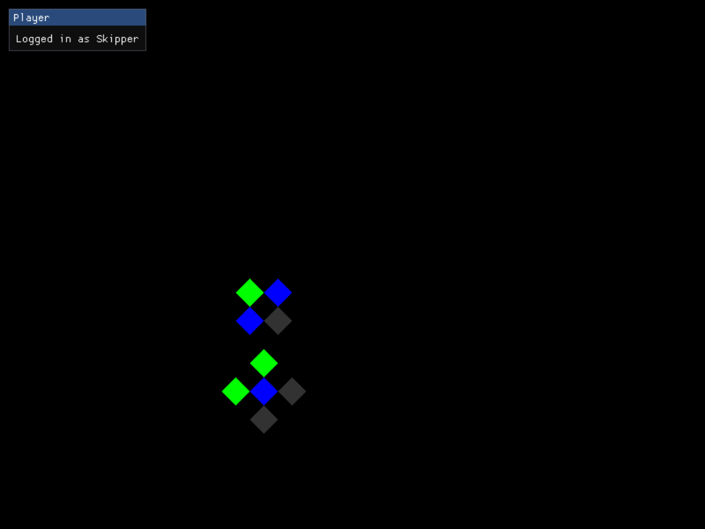

# tileship
A turn-based strategy game on an isometric tile engine (early stage): accounts and
log in through the server, then the first map. SFML 3.1, ImGui, kazilib (enet and its
packet layer), MySQL.

**Play it in your browser: https://kazin.dev/projects/tileship/**



## What it does now

- **Log in / Create Account** (ImGui window): a name of 1-32 letters, digits or `_` and a
  password. The server keeps the accounts in MySQL (table `players`: the name, a random
  salt and `SHA2(salt + password)`; the server makes the table when it is missing).
  Wrong password, a taken name, a lost server: told in the window. The client reconnects
  by itself (every 3 s after a lost connection).
- **The map**: after the log in, the first test map (`GameScene`, isometric diamonds:
  grass, water, rock) and the player's name. The turn-based game itself is still to come.

## Libraries

| Library | Version | Where |
|---------|---------|-------|
| kazilib | master (submodule) | `src/dep/kazilib`: enet 1.3.18, `net/packet.h` / `net/socket.h` / `net/broadcaster.h` (the packets), `scene/manager.h` (the scenes), `initflags.h` (flags and `init.json`), `log.h`, ImGui 1.84 + ImGui-SFML, `net/ws_gateway.h`, `web/` |
| SFML | 3.1.0 x86 | `src/dep/SFML-3.1.0`: a junction to `D:\code\kazilib\SFML-3.1.0`, or the official vc17 32-bit release |
| MySQL C API | Connector/C 6.1.11 x86 (Windows), libmysqlclient 8.4 (Linux) | `src/dep/mysql-connector-c-6.1.11-win32` (downloaded by `setup.ps1`); apt `libmysqlclient-dev` |

## Building (Windows)

Visual Studio 2026 (v145 toolset). FASTBuild v1.20 is found next to the checkouts or
downloaded once.

```
git clone --recurse-submodules https://github.com/xkazinx/tileship.git
powershell -ExecutionPolicy Bypass -File build.ps1
```

`build.ps1` runs `setup.ps1` (the kazilib submodule, SFML, the MySQL connector, a
`deploy\server\init.json` from `src\server\init.json.example`), then kazilib's FASTBuild
runner on `src\fastbuild.json`: Release, x86, 64-bit-hosted compiler and linker,
distributed to the workers that answer (MSBuild when FASTBuild is missing). Output:
`deploy\server\server.exe` (+ `libmysql.dll`), `deploy\client\client.exe` (+ SFML's DLLs).
`build.ps1 client` / `server` builds one. Visual Studio builds the same from `src\tileship.sln`.

## Running

1. A MySQL (5.7 / 8.x) with a database and an account for the server, written in
   `deploy\server\init.json` (never committed):
   `{"db_host": "127.0.0.1", "db_port": 3306, "db_user": "tileship", "db_pass": "...", "db_name": "tileship"}`.
   The Windows connector (6.1) needs the account on `mysql_native_password` and speaks no
   TLS to MySQL 8 (`db_ssl` is off on Windows; on for Linux).
2. `deploy\server\server.exe`: ENet on UDP 7021 (`port=`), the WebSocket gateway on
   127.0.0.1:7020 (`ws=`, `ws_bind=`, `web=`: the browser build's files, default the exe's
   `web\`).
3. `deploy\client\client.exe` (twice for two players): `ip=<host> port=<n>` (default
   127.0.0.1:7021), or `init.json` beside it. Test flags: `user=<name> pass=<password>`
   log in at once (`create`: make the account first), `shot=<file.png>` saves the window
   in the game (`quitaftershot`).

## In a web browser

The same client compiled to WebAssembly (Emscripten) plays against the same server:
kazilib's SFML web port (`src\dep\kazilib\web\`), ImGui drawn through SFML there, and the
client's ENet carried over one WebSocket (`enet/websocket.cpp`) to the server's gateway,
which hands each browser to the server as an ENet peer.

```
powershell -ExecutionPolicy Bypass -File build_web.ps1
```

`build_web.ps1` builds `src\client\CMakeLists.txt` against the SFML web build in
`D:\code\tools\kazilib-web` (made by kazilib's `web\build_deps.ps1` when missing) and copies
it to `deploy\server\web\`; start the server and open http://127.0.0.1:7020/.
Launch flags in a browser are the query string (`?ws=wss://host/path/ws`); the WebSocket
defaults to the page's folder + `ws`.

## Linux server and the deployment

```
powershell -ExecutionPolicy Bypass -File build_linux.ps1     # src\build\linux\tileship_server
powershell -ExecutionPolicy Bypass -File deploy_ubuntu.ps1   # both builds, upload, install
```

`build_linux.ps1` builds `src\server\CMakeLists.txt` in Docker (`tileship-linux-build:26.04`:
Ubuntu 26.04, g++ 15, libmysqlclient-dev). `deploy_ubuntu.ps1` installs on the box
(`deploy\ubuntu\install.sh`): the service `tileship` (`/opt/tileship`, user `tileship`,
`port=7021 ws=7020 ws_bind=127.0.0.1`), the web build in `/opt/tileship/web`, Caddy's
`kazin.dev/projects/tileship` with `/projects/tileship/ws` to the gateway; the first install
makes MySQL's database `tileship` and `tileship@localhost` with a random password, written
only to `/opt/tileship/bin/init.json` (mode 600). UDP 7021 is not open on the box's
firewall: the live server is browser-only.

## Testing

`src\tests\web\run_web_test.ps1`: two headless Edge tabs (kazilib `web\tools\browser.js`)
against a local server (ports 7031 / 7030, `deploy\server\init.json`'s database) or
`-Url https://kazin.dev/projects/tileship/`: an account made and logged in, a refused log
in, a second account, both in the game. Screenshots in `testerino\web\`. Showcase shots:
`docs\showcase\`.

---

## Original README (2021-08-12, 901ffc3)

# Tileship: Strategy Turn-Based Tile-Engine Game

1. Download [Visual Studio Community 2019](https://visualstudio.microsoft.com/es/downloads/)
  
2. Create folder `C:\LIBPATH`
> All dependencies will be stored here to share between various projects
- Create environment variable for the created folder
  - Press Windows key
  - Search for `edit the system environment variables`
  - Click on `Environment Variables`
  - Click `New`
  - Set name as `LIBPATH` and value as `C:\LIBPATH`
  
3. Download [SFML](https://www.sfml-dev.org/files/SFML-2.5.1-windows-vc15-32-bit.zip)
- Extract in `LIBPATH` folder

4. Download and Compile [ENet](http://enet.bespin.org/Downloads.html)
- Extract in `LIBPATH` folder
- Run project `enet.dsp`
- In `Solution Explorer`, right click the `enet` project, press on `Properties` and in `C/C++`->`General` change `Debug Information Format` from `Program Database for Edit and Continue (/ZI)` to `Program Database (/Zi)`
- Build Solution (Ctrl+Shift+B) both in `Debug` and `Release` (the dropdown to toggle between them can be found at the top)
> This will generate `enet.lib` to use it both in `Debug` and `Release` projects

5. Download and setup latest `MySQL Server` from [MySQL Community Installer](https://dev.mysql.com/downloads/windows/installer/8.0.html)

6. Download [MySQL C Connector 6.1 - Windows (x86, 32-bit), MSI Installer](https://downloads.mysql.com/archives/c-c/)
> Should be automatically be installed in %ProgramFiles(x86)%\MySQL\
> This provides the `include` files and `.dll` files for the `server` project

7. Clone `tileship` repository

8. Run `symlinks.bat` as Administrator
> This will link `.dll` files from libraries placed at LIBPATH folder into the `deploy` project's directories

9. Open `src\tileship.sln`
- Build Solution (Ctrl+Shift+B)

10. Setup Debugging and opening with Ctrl+F5
> Client
- In `Solution Explorer`, right click the `client` project, press on `Properties`, and in `Debugging` set:
  - Make sure to first set `Configuration` at top as `All configurations` so that it applies both for Debug and Release
- Command: `$(SolutionDir)..\deploy\client\$(TargetName)$(TargetExt)`
- Working Directory: `$(SolutionDir)..\deploy\client\`
> Server
- In `Solution Explorer`, right click the `server` project, press on `Properties`, and in `Debugging` set:
  - Make sure to first set `Configuration` at top as `All configurations` so that it applies both for Debug and Release
- Command: `$(SolutionDir)..\deploy\server\$(TargetName)$(TargetExt)`
- Working Directory: `$(SolutionDir)..\deploy\server\`

##Workflow

- Use a MySQL Manager like [HeidiSQL](https://www.heidisql.com/)

- Use [Virtual Assist X](https://www.wholetomato.com/downloads) (recommended)
  > Visual Studio extension that provides tools for faster code browsing and development
  - To reset trial every 30 days:
    - Remove all `*.TMP` files in `C:\Users\[UserName]\AppData\Local\Temp`
    - Remove registry folder at "HKEY_CURRENT_USER\SOFTWARE\Licenses"
  
- Use Visual Studio's `Live Share` (download from Visual Studio 2019 itself)

- Use [Google Drive](https://www.google.com/intl/es/drive/download/) to sync the compiled `client.exe` and `server.exe`
  > So when using `Live Share` and host's computer compiles the projects, it could be set with `symlinks` so that the compiled files are shared with the host and the participants

- Use [AnyDesk](https://anydesk.com/es) in case we both need remote access
  > Like, to see something in the same executable, code synchronously, or debug at the same time
